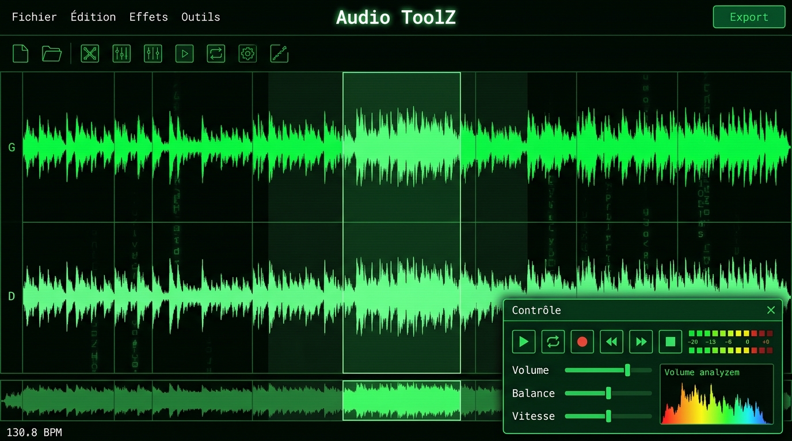

<div align="center">


# Audio ToolZ

**Éditeur audio de précision, gratuit et open source — inspiré de GoldWave.**

Traitement 100 % local : votre audio ne quitte jamais votre machine.

[](LICENSE)
[](https://react.dev)
[](https://www.typescriptlang.org)
[](https://vite.dev)
[](#-version-windows-portable)

</div>

---

<div align="center">

</div>

## ✨ Fonctionnalités

### 🎛️ Édition

- **Édition multi-documents** : ouvrez et travaillez plusieurs fichiers simultanément
- **Couper, copier, coller** au curseur ou en remplacement de la sélection
- **Silence** sur la sélection, **rogner** pour ne garder que la sélection
- **Annuler / Rétablir** avec 30 niveaux d'historique par document
- **Sélection à l'échantillon près** à la souris, avec magnétisme optionnel sur les temps
- **Piste de démo générée** (10 s) pour tester l'éditeur dès l'ouverture, sans aucun fichier

### 🎚️ Effets & traitement du signal

| Effet | Détails |
|---|---|
| **Volume** | Gain en dB, borné à ±1 (anti-écrêtage) |
| **Normaliser** | Cible de pic en dB, calculée sur la sélection ou tout le fichier |
| **Fondus** | Entrée / sortie avec courbes **linéaire**, **exponentielle** ou **S-curve** |
| **Vitesse & Hauteur** | Vitesse 0,25× à 4×, pitch ±12 demi-tons, **préservation de la hauteur** par time-stretching WSOLA |

Tous les effets s'appliquent à la **sélection** si elle existe, sinon à l'ensemble du fichier.

### 🥁 Détection de BPM

- Détection automatique du tempo (**65 à 300 BPM**, précision 0,01 BPM)
- Grille de temps superposée à la forme d'onde
- Repères d'**attaques de kick** détectés à l'échantillon près
- **Magnétisme de la sélection sur les temps** pour des coupes calées sur le morceau

### 📈 Analyse & visualisation

- **Forme d'onde** stéréo haute résolution (min/max/RMS par bloc, canvas)
- **Oscilloscope**, **spectre** et **forme d'onde colorée** en temps réel
- **VU-mètres stéréo** peak + RMS pendant la lecture et l'enregistrement
- **Statistiques audio** : durée, pic (linéaire et dB), RMS, offset DC, échantillons écrêtés

### ▶️ Lecture & transport

- Lecture, pause, **boucle sur sélection** (ajustable en direct), **lecture à l'envers**
- **Vitesse de lecture** 0,25× à 4× sans coupure du playhead
- **Volume** (dB) et **balance** réglables en temps réel
- **Écoute par canal** : muet gauche / droite séparément
- Fenêtre de contrôle **flottante** et repositionnable

### 🎤 Enregistrement

- Enregistrement **micro** avec choix du périphérique d'entrée
- Options **réduction de bruit**, **annulation d'écho** et **gain automatique** désactivables
- VU-mètres live pendant l'enregistrement

### 💾 Import / Export

| Format | Options |
|---|---|
| **WAV** | 16 / 24 bits PCM, 32 bits IEEE Float |
| **MP3** | 128 / 192 / 256 / 320 kbps |
| **FLAC** | Niveaux de compression 0 / 2 / 5 (encodeur FLAC intégré, sans dépendance) |
| **OGG Vorbis** | Qualité −1 à 10 |

- Export du **fichier complet ou de la sélection uniquement**
- Décodage de tout format supporté par le navigateur (WAV, MP3, FLAC, OGG, M4A…)

### 📀 Feuilles .cue & assemblage

- **Joindre plusieurs fichiers** en un seul mix, avec métadonnées titre / artiste
- **Génération d'une feuille .cue** à partir des fichiers joints (pistes, interprètes)
- **Import d'un fichier .cue** sur la piste et **extraction** du .cue depuis un mix existant

### 🔊 Périphériques audio

- Sélection du **périphérique d'entrée** (micro) et de **sortie** (casque, enceintes…)
- Mémorisation des périphériques et préférences d'enregistrement entre les sessions

### 🔒 Vie privée

- **Aucune donnée envoyée en ligne** : décodage, effets, encodage et export sont exécutés localement dans votre navigateur.

## 🚀 Démarrage rapide

### Prérequis

- [Node.js](https://nodejs.org) 20+ (ou [Bun](https://bun.sh))

### Installation

```bash
git clone https://github.com/x-R0b0T-x/Audio-ToolZ.git
cd Audio-ToolZ
npm install
npm run dev
```

L'application est disponible sur `http://localhost:3000`.

> Si `npm install` signale un conflit de dépendances, utilisez `npm install --legacy-peer-deps`.

### Build de production

```bash
npm run build
npm run preview
```

## 📦 Version Windows portable

Un kit Windows est fourni dans `public/Audio-ToolZ-Windows.zip`. Après extraction, le script PowerShell inclus permet de générer un **`Audio ToolZ.exe`** autonome (via Electron) avec logo, raccourci bureau et mémorisation de la position de fenêtre.

## ⌨️ Raccourcis clavier

| Raccourci | Action |
|---|---|
| `Espace` | Lecture / Pause |
| `Ctrl+O` / `Ctrl+E` | Ouvrir / Exporter |
| `Ctrl+N` | Nouveau document vierge |
| `Ctrl+Z` / `Ctrl+Y` | Annuler / Rétablir |
| `Ctrl+X` / `Ctrl+C` / `Ctrl+V` | Couper / Copier / Coller |
| `Suppr` | Silence sur la sélection |
| `Ctrl+T` | Rogner à la sélection |
| `Ctrl+A` | Tout sélectionner |
| `Ctrl+B` | Détecteur de BPM / repères de kicks |
| `Molette souris` | Zoom sur le pointeur |

## 🏗️ Architecture

```
src/
├── audio/
│   ├── dsp.ts               # Traitement du signal (pur, testé) : édition, WSOLA,
│   │                        #   resampling cubique, détection BPM, statistiques
│   ├── engine.ts            # Moteur Web Audio : lecture, boucle, reverse,
│   │                        #   enregistrement, VU-mètres, périphériques
│   ├── cueSheet.ts          # Lecture / écriture des feuilles .cue
│   ├── encoders/            # Export WAV, FLAC (encodeur intégré), MP3, OGG
│   └── types.ts             # Types partagés
├── components/              # UI : forme d'onde (canvas), transport, modales
├── utils/                   # Persistance de l'état de l'interface
└── App.tsx                  # Orchestration des documents et raccourcis
```

## 🧪 Tests

```bash
node --import tsx --test src/audio/dsp.test.ts src/audio/cueSheet.test.ts src/audio/encoders.test.ts src/utils/uiStateStorage.test.ts
```

## 🤝 Contribution

Les contributions sont bienvenues ! Ouvrez une *issue* pour proposer une fonctionnalité ou signaler un bug, puis soumettez une *pull request*.

## 📄 Licence

Ce projet est distribué sous licence **[GNU GPL v3](LICENSE)** — gratuit, sans publicité, sans télémétrie.
